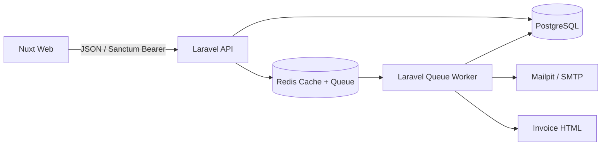

# Arsitektur

## Konteks Sistem

## Lapisan (Layers)
- **HTTP:** Menangani rute (*routes*), *middleware*, *Form Requests*, *Resources*, dan *controllers*.
- **Aplikasi/Domain:** `OrderService`, `OrderStateMachine`, `StockService`, dan `IdempotencyService` yang mengelola *use case* serta aturan bisnis (*invariants*).
- **Persistensi:** Menggunakan model Eloquent, migrasi database, indeks, *factories*, dan *seeders*.
- **Asinkron (Async):** Menangani antrean untuk pembuatan faktur/email dan notifikasi stok menipis (*low-stock notifications*).
- **Frontend:** Nuxt *pages/layouts*, *typed API client*, Vue Query *composables*, dan navigasi berbasis peran pengguna (*role-aware navigation*).

## ADR-001 — Konsistensi Stok (Stock Consistency)
- **Konteks:** Kasir yang mengakses sistem secara bersamaan (*concurrent*) tidak boleh menjual produk melebihi stok yang tersedia (*oversell*).
- **Pilihan:** *Optimistic retries*, pembaruan bersyarat (*conditional updates*), atau penguncian baris pesimis (*pessimistic row locks*).
- **Keputusan:** **Mengunci baris produk menggunakan `lockForUpdate()` di dalam database transaction**. Baris diurutkan berdasarkan ID produk untuk meminimalkan risiko *deadlock*. Validasi seluruh jumlah (kuantitas) barang dilakukan sebelum pengurangan stok. Riwayat transaksi (*ledger*) ditulis dalam transaksi yang sama.
- **Konsekuensi:** Menjamin konsistensi yang kuat (*strong consistency*) pada PostgreSQL. Namun, perebutan akses (*contention*) dapat menurunkan *throughput* pada produk yang sangat laris (*hot products*). Jika diperlukan, lakukan *retry* otomatis pada *deadlock* transien di tingkat aplikasi.

## ADR-002 — Idempotensi (Idempotency)
- **Konteks:** Klien/frontend mungkin mengirim ulang permintaan `POST /orders` jika terjadi *network timeout*.
- **Pilihan:** Menggunakan Redis *key* atau kunci unik (*unique key*) pada database.
- **Keputusan:** **Menggunakan tabel `idempotency_keys` yang persisten**. Tabel ini dilengkapi dengan *unique key*, *fingerprint* SHA-256 dari *request*, status proses (*processing/completed*), data *HTTP response* yang disimpan, dan waktu kedaluwarsa. Permintaan dengan kunci dan *payload* yang sama akan memutar kembali (*replay*) respon yang tersimpan. Kunci yang sama dengan *payload* berbeda akan menghasilkan eror 409 (*Conflict*). Permintaan pertama yang masuk bersamaan akan diurutkan berdasarkan *unique key* pada baris database.
- **Konsekuensi:** Data tetap aman dan bertahan meski Redis di-*restart*. Data yang kedaluwarsa dapat dibersihkan secara berkala menggunakan Laravel *scheduler*.

## ADR-003 — Autentikasi (Authentication)
- **Konteks:** Backend berupa API terpisah yang diakses oleh Nuxt.
- **Pilihan:** Rotasi *JWT access/refresh token* atau Laravel Sanctum *personal access tokens*.
- **Keputusan:** **Menggunakan Laravel Sanctum bearer tokens** sesuai kebutuhan *Track B*, lengkap dengan konfigurasi kedaluwarsa token dan fungsi penghapusan token saat keluar sistem (*revoke-on-logout*).
- **Konsekuensi:** Proses pencabutan hak akses di sisi server menjadi lebih mudah. Frontend wajib mengamankan penyimpanan token dan menghapus sesi jika menerima respon 401 (*Unauthorized*). Untuk penerapan produksi pada browser, arsitektur sesi berbasis *cookie HttpOnly* yang aman lebih direkomendasikan jika topologi domain memungkinkan.

## Skala ke 50.000 Pesanan/Hari / Multi-Cabang
Untuk mendukung skala ini, data akan dipisahkan berdasarkan penyewa/cabang (*tenant/branch partition*). Sistem akan menggunakan tabel inventaris dan reservasi khusus per cabang, menerapkan *outbox pattern* untuk pengiriman *event* yang andal, menggunakan kolam antrean (*queue pools*) khusus, serta menyediakan *read replicas* untuk kebutuhan laporan. Selain itu, akan diterapkan agregat data yang dimaterialisasi (*materialized aggregates*), pelacakan dengan OpenTelemetry, penskalaan API/worker secara horizontal, dan pengujian beban (*load tests*). Proses penulisan stok tetap dipertahankan pada database utama (*primary database*), dan kepemilikan inventaris didefinisikan secara jelas di tiap cabang.

## DECISION
Sebelum mengirimkan dokumen ini, jawab pertanyaan berikut dengan kalimat Anda sendiri dan sebutkan nama file atau fungsi konkret yang digunakan:
1. Bagaimana cara implementasi sistem mencegah stok bernilai negatif saat menerima banyak permintaan bersamaan (*concurrent requests*)?
2. Mengapa struktur lapisan/folder ini yang dipilih dan bagaimana rencana pengembangannya ke depan?
3. Sebutkan satu *bug* nyata yang ditemukan saat implementasi dan bagaimana Anda mendiagnosisnya.
4. Apa saja area yang masih belum lengkap/lemah dan apa langkah konkret selanjutnya untuk memperbaikinya?

# Arsitektur Proyek: azatech-order-management
## JAWABAN

Dokumen ini menjelaskan struktur lapisan sistem, strategi penanganan konkurensi data inventaris, dan cetak biru (roadmap) pengembangan sistem ke depan.

## 1. Pemisahan Lapisan Sistem (Layers Separation)

Sistem backend dibangun di atas kerangka kerja Laravel dengan mengadopsi prinsip *Separation of Concerns* (SoC) untuk memisahkan tanggung jawab kode secara tegas:

*   **HTTP Layer:** 
    *   *Tanggung Jawab:* Menangani siklus *request-response* API publik, menyaring akses, dan memvalidasi struktur data mentah.
    *   *Komponen Utama:* Rute API (`routes/api.php`), Middleware (`RequestId.php`), Form Requests, serta Controllers seperti `Http/Controllers/Api/OrderController.php` dan `ProductController.php`. Lapisan ini dilarang keras memuat logika manipulasi database langsung.
*   **Application / Domain Layer:** 
    *   *Tanggung Jawab:* Menjadi pusat eksekusi seluruh aturan bisnis inti (*business invariants*) dan mutasi status data tanpa terikat pada protokol HTTP.
    *   *Komponen Utama:* Kelas layanan mandiri seperti `app/Services/OrderService.php`, `app/Services/StockService.php`, dan logika State Machine transisi order (`app/Domain/Order/OrderStateMachine.php`).
*   **Persistence Layer:** 
    *   *Tanggung Jawab:* Mengelola representasi, penyimpanan, indeksasi, dan integritas data pada PostgreSQL.
    *   *Komponen Utama:* Model Eloquent (`app/Models/Order.php`, `Product.php`, `StockMovement.php`), Skema Migrasi (`database/migrations/2026_01_01_000000_create_core_tables.php`), serta Seeders (`database/seeders/DatabaseSeeder.php`).
*   **Async / Event Layer:** 
    *   *Tanggung Jawab:* Memproses tugas-tugas dengan komputasi berat secara asinkron di latar belakang menggunakan worker antrean berbasis Redis untuk menjaga latensi API tetap rendah.
    *   *Komponen Utama:* `app/Jobs/GenerateInvoiceJob.php`, `app/Jobs/ProcessPaidOrder.php`, dan `app/Jobs/LowStockNotificationJob.php`.

---

## 2. Strategi Konsistensi Stok Konkuren (Concurrent Stock Strategy)

Sistem mencegah terjadinya kondisi balapan (*race condition*) dan stok bernilai negatif (*overselling*) saat menerima banyak permintaan pesanan bersamaan dengan menerapkan **Pessimistic Row Locking** langsung di tingkat database.

### Alur Eksekusi & Batasan Transaksi (Transaction Boundary)
Seluruh rangkaian operasi pemeriksaan stok, pengurangan kuantitas, hingga penulisan log mutasi wajib dibungkus di dalam satu batasan transaksi database murni (`DB::transaction`).

1.  **Deadlock Prevention:**ID Produk yang diminta diurutkan terlebih dahulu secara merangkak naik (*ascending*) sebelum kueri dijalankan. Hal ini krusial untuk mencegah *deadlock* silang antar transaksi konkuren.
2.  **Row Locking:** Baris data produk dikunci menggunakan klausa `lockForUpdate()` milik Eloquent. Transaksi konkuren lain yang mencoba mengakses produk yang sama akan ditahan di antrean database sampai transaksi saat ini melakukan komit (`commit`) atau pembatalan (`rollback`).
3.  **Invariant Validation:** Setelah baris dikunci, sisa kuantitas stok aktual dibaca dari memori database yang aman. Jika stok kurang dari permintaan, sistem melempar `InsufficientStockException` yang otomatis memicu *rollback* transaksi demi menjaga atomisitas.

---

## 3. Rencana Peta Jalan Skalabilitas (Roadmap to 50k Orders/Day)

Untuk mendukung pertumbuhan transaksi masif dan arsitektur multi-cabang (multi-tenant), arsitektur backend akan dikembangkan melalui langkah-langkah konkret berikut:

1.  **Pemisahan Infrastruktur Database (Read/Write Split):** Mengonfigurasi lapisan persistensi Laravel untuk mengarahkan operasi tulis dan penguncian (`lockForUpdate`) ke database *PostgreSQL Master*, serta mengarahkan kueri baca/dashboard ke *PostgreSQL Read Replica*.
2.  **Pool Antrean Khusus (Dedicated Queue Pools):** Memisahkan pemicuan worker antrean asinkron berdasarkan prioritas beban kerja (`php artisan queue:work --queue=high,default,low`) untuk memastikan `ProcessPaidOrder` tidak terhambat oleh proses pencetakan dokumen lambat pada `GenerateInvoiceJob`.
3.  **Tabel Reservasi Inventaris (Inventory Reservations):** Mengganti skema penguncian langsung pada baris tabel produk utama dengan tabel reservasi inventaris terpisah, guna meningkatkan *throughput* transaksi pada produk-produk populer (*hot products*).

## 4 Apa saja area yang masih belum lengkap/lemah dan apa langkah konkret selanjutnya untuk memperbaikinya?

1. Area yang saat ini diidentifikasi masih lemah adalah arsitektur autentikasi untuk deployment produksi berskala besar serta skalabilitas pemrosesan data antrean.
A. **Kelemahan saat Ini:** Penggunaan *Sanctum bearer tokens* yang disimpan di sisi klien (frontend Nuxt) saat ini masih memiliki keterbatasan keamanan dan fungsionalitas jika harus mengelola topologi multi-cabang yang masif. Selain itu, pemrosesan antrean asinkron untuk notifikasi stok dan pembuatan invoice belum dipisahkan secara murni berdasarkan beban kerja.
B. **Langkah Konkret Perbaikan:**
	1. Mengubah arsitektur autentikasi pada deployment produksi menggunakan HttpOnly cookie-based session architecture yang lebih aman untuk aplikasi berbasis browser seperti Nuxt.
	2. **Memisahkan kolam antrean (dedicated queue pools)** secara khusus untuk memisahkan beban kerja kritis (seperti pemrosesan pesanan/stok) dengan beban kerja sekunder (notifikasi/email).
	3. **Mengimplementasikan OpenTelemetry tracing** untuk memantau performa latensi dan hambatan (bottleneck) di sepanjang alur transaksi dari Nuxt menuju Laravel API hingga PostgreSQL dan Redis.