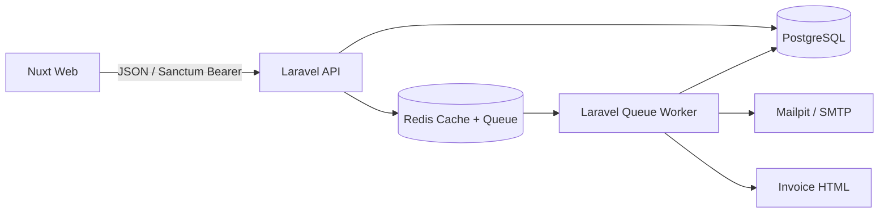

# Architecture

## System context

## Layers
- HTTP: routes, middleware, Form Requests, Resources, controllers.
- Application/domain: `OrderService`, `OrderStateMachine`, `StockService`, `IdempotencyService` own use cases and invariants.
- Persistence: Eloquent models, migrations, indexes, factories and seeders.
- Async: queued invoice/email and low-stock notifications.
- Frontend: Nuxt pages/layouts, typed API client, Vue Query composables and role-aware navigation.

## ADR-001 — Stock consistency
**Context:** concurrent cashiers must not oversell. **Options:** optimistic retries, conditional updates, pessimistic row locks. **Decision:** lock product rows with `lockForUpdate()` in a transaction, sorted by product ID to reduce deadlocks; validate all quantities before decrementing; write ledger rows in the same transaction. **Consequences:** strong consistency on PostgreSQL; contention can reduce throughput for hot products. Retry transient deadlocks at the application boundary if needed.

## ADR-002 — Idempotency
**Context:** clients may retry POST /orders after network timeouts. **Options:** Redis key, database unique key. **Decision:** persistent `idempotency_keys` table with unique key, request SHA-256 fingerprint, processing/completed state, stored HTTP response and expiry. Same key+same payload replays response; same key+different payload returns 409; concurrent first requests serialize on the unique key/row. **Consequences:** durable across Redis restarts; expired records can be pruned by scheduler.

## ADR-003 — Authentication
**Context:** backend is a separate API used by Nuxt. **Options:** JWT access/refresh rotation, Sanctum personal access tokens. **Decision:** Track B requirement uses Sanctum bearer tokens with configured expiration and revoke-on-logout. **Consequences:** simpler server-side revocation; frontend must protect token storage and clear session on 401. For production browser deployments prefer secure HttpOnly cookie-based session architecture where domain topology permits.

## Scale to 50,000 orders/day / multiple branches
Partition data by tenant/branch, introduce branch-scoped inventory and reservation tables, use outbox pattern for reliable events, dedicated queue pools, read replicas for reporting, materialized aggregates, OpenTelemetry tracing, horizontal API/worker scaling, and load tests. Keep stock writes on the primary database and define per-branch inventory ownership.

## Decisions (candidate completion required)
Before submission, answer in your own words and cite the actual files/functions:
1. How the implementation prevents negative stock under concurrent requests.
2. Why the layers/folder structure were selected and how they would evolve.
3. A real bug encountered during implementation and how it was diagnosed.
4. Incomplete/weak areas and concrete next steps.
