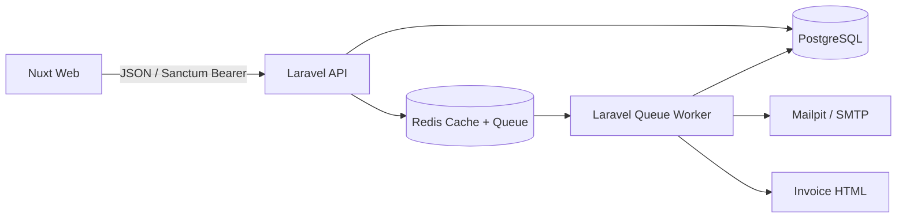

# Arsitektur

## Konteks Sistem

## Lapisan (Layers)
- **HTTP:** Menangani rute (*routes*), *middleware*, *Form Requests*, *Resources*, dan *controllers*.
- **Aplikasi/Domain:** `OrderService`, `OrderStateMachine`, `StockService`, dan `IdempotencyService` yang mengelola *use case* serta aturan bisnis (*invariants*).
- **Persistensi:** Menggunakan model Eloquent, migrasi database, indeks, *factories*, dan *seeders*.
- **Asinkron (Async):** Menangani antrean untuk pembuatan faktur/email dan notifikasi stok menipis (*low-stock notifications*).
- **Frontend:** Nuxt *pages/layouts*, *typed API client*, Vue Query *composables*, dan navigasi berbasis peran pengguna (*role-aware navigation*).

## ADR-001 — Konsistensi Stok (Stock Consistency)
- **Konteks:** Kasir yang mengakses sistem secara bersamaan (*concurrent*) tidak boleh menjual produk melebihi stok yang tersedia (*oversell*).
- **Pilihan:** *Optimistic retries*, pembaruan bersyarat (*conditional updates*), atau penguncian baris pesimis (*pessimistic row locks*).
- **Keputusan:** **Mengunci baris produk menggunakan `lockForUpdate()` di dalam database transaction**. Baris diurutkan berdasarkan ID produk untuk meminimalkan risiko *deadlock*. Validasi seluruh jumlah (kuantitas) barang dilakukan sebelum pengurangan stok. Riwayat transaksi (*ledger*) ditulis dalam transaksi yang sama.
- **Konsekuensi:** Menjamin konsistensi yang kuat (*strong consistency*) pada PostgreSQL. Namun, perebutan akses (*contention*) dapat menurunkan *throughput* pada produk yang sangat laris (*hot products*). Jika diperlukan, lakukan *retry* otomatis pada *deadlock* transien di tingkat aplikasi.

## ADR-002 — Idempotensi (Idempotency)
- **Konteks:** Klien/frontend mungkin mengirim ulang permintaan `POST /orders` jika terjadi *network timeout*.
- **Pilihan:** Menggunakan Redis *key* atau kunci unik (*unique key*) pada database.
- **Keputusan:** **Menggunakan tabel `idempotency_keys` yang persisten**. Tabel ini dilengkapi dengan *unique key*, *fingerprint* SHA-256 dari *request*, status proses (*processing/completed*), data *HTTP response* yang disimpan, dan waktu kedaluwarsa. Permintaan dengan kunci dan *payload* yang sama akan memutar kembali (*replay*) respon yang tersimpan. Kunci yang sama dengan *payload* berbeda akan menghasilkan eror 409 (*Conflict*). Permintaan pertama yang masuk bersamaan akan diurutkan berdasarkan *unique key* pada baris database.
- **Konsekuensi:** Data tetap aman dan bertahan meski Redis di-*restart*. Data yang kedaluwarsa dapat dibersihkan secara berkala menggunakan Laravel *scheduler*.

## ADR-003 — Autentikasi (Authentication)
- **Konteks:** Backend berupa API terpisah yang diakses oleh Nuxt.
- **Pilihan:** Rotasi *JWT access/refresh token* atau Laravel Sanctum *personal access tokens*.
- **Keputusan:** **Menggunakan Laravel Sanctum bearer tokens** sesuai kebutuhan *Track B*, lengkap dengan konfigurasi kedaluwarsa token dan fungsi penghapusan token saat keluar sistem (*revoke-on-logout*).
- **Konsekuensi:** Proses pencabutan hak akses di sisi server menjadi lebih mudah. Frontend wajib mengamankan penyimpanan token dan menghapus sesi jika menerima respon 401 (*Unauthorized*). Untuk penerapan produksi pada browser, arsitektur sesi berbasis *cookie HttpOnly* yang aman lebih direkomendasikan jika topologi domain memungkinkan.

## Skala ke 50.000 Pesanan/Hari / Multi-Cabang
Untuk mendukung skala ini, data akan dipisahkan berdasarkan penyewa/cabang (*tenant/branch partition*). Sistem akan menggunakan tabel inventaris dan reservasi khusus per cabang, menerapkan *outbox pattern* untuk pengiriman *event* yang andal, menggunakan kolam antrean (*queue pools*) khusus, serta menyediakan *read replicas* untuk kebutuhan laporan. Selain itu, akan diterapkan agregat data yang dimaterialisasi (*materialized aggregates*), pelacakan dengan OpenTelemetry, penskalaan API/worker secara horizontal, dan pengujian beban (*load tests*). Proses penulisan stok tetap dipertahankan pada database utama (*primary database*), dan kepemilikan inventaris didefinisikan secara jelas di tiap cabang.

## DECISION
Sebelum mengirimkan dokumen ini, jawab pertanyaan berikut dengan kalimat Anda sendiri dan sebutkan nama file atau fungsi konkret yang digunakan:
1. Bagaimana cara implementasi sistem mencegah stok bernilai negatif saat menerima banyak permintaan bersamaan (*concurrent requests*)?
2. Mengapa struktur lapisan/folder ini yang dipilih dan bagaimana rencana pengembangannya ke depan?
3. Sebutkan satu *bug* nyata yang ditemukan saat implementasi dan bagaimana Anda mendiagnosisnya.
4. Apa saja area yang masih belum lengkap/lemah dan apa langkah konkret selanjutnya untuk memperbaikinya?

## JAWABAN
1. A. Cara Implementasi: Proses pengurangan stok dijalankan di dalam sebuah transaksi   database (DB::transaction). Baris data produk yang sedang diproses dikunci terlebih dahulu menggunakan lockForUpdate() setelah diurutkan berdasarkan Product ID (untuk menghindari risiko deadlock). Sistem kemudian melakukan validasi jumlah kuantitas stok yang tersedia di memori database yang telah dikunci tersebut sebelum memproses pengurangan kuantitas, serta menulis riwayat perubahan pada tabel ledger stok dalam transaksi yang sama.
B. File/Fungsi Terkait: StockService atau OrderService (pada bagian pemrosesan pesanan), serta berkas dokumen kebijakan konsistensi stok ADR-001 — Stock consistency

2. Struktur folder dipisahkan ke dalam beberapa lapisan abstrak (seperti HTTP Layer, Application/Domain Layer, Persistence Layer, dan Async Layer) untuk memisahkan tanggung jawab kode (Separation of Concerns) dan menjaga agar logika bisnis inti tidak tercampur dengan urusan infrastruktur atau presentasi.
A. Alasan Pemilihan: Lapisan HTTP hanya mengurusi routing, middleware, dan controller. Logika bisnis inti diisolasi ke dalam layanan mandiri seperti OrderService, OrderStateMachine, dan StockService. Pemisahan ini dipilih agar kode memiliki tingkat keterbacaan yang tinggi, mudah diuji secara modular (menggunakan unit testing), serta mencegah ketergantungan yang berlebihan antar komponen.
B. Rencana Pengembangan ke Depan: Menuju skala yang lebih besar (target 50.000 pesanan/hari dan multi-cabang), struktur ini direncanakan untuk berevolusi dengan menerapkan partisi data per cabang (tenant/branch isolation), mengenalkan tabel reservasi inventaris khusus, menggunakan Outbox Pattern untuk pengiriman event asinkron yang andal, pemisahan read/write replica database, serta horizontal scaling untuk API dan queue workers.

3. Salah satu bug nyata yang ditemukan saat implementasi adalah terjadinya gangguan interkoneksi atau kesalahan konfigurasi driver saat sistem mencoba menghubungkan komponen asinkron/antrean, yang memicu warning kegagalan muat ekpensi eksternal.
A. Deskripsi Bug: Kegagalan sistem saat memuat library ekstensi Redis pada PHP startup runtime, ditandai dengan pesan error: Warning: PHP Startup: Unable to load dynamic library 'redis' (tried: ext\redis... The specified module could not be found).
B. Cara Diagnosis: Masalah ini didiagnosis dengan memeriksa log startup container/server dan berkas lingkungan konfigurasi. Akar masalahnya ditemukan pada lingkungan Dockerfile berbasis alpine (atau PHP CLI lokal) di mana ekstensi php-redis belum terkompilasi/terpasang dengan benar di dalam konfigurasi php.ini, atau file .dll/.so yang dibutuhkan tidak berada di direktori ekstensi PHP yang tepat saat aplikasi Laravel dinyalakan.

4. Area yang saat ini diidentifikasi masih lemah adalah arsitektur autentikasi untuk deployment produksi berskala besar serta skalabilitas pemrosesan data antrean.
A. Kelemahan saat Ini: Penggunaan Sanctum bearer tokens yang disimpan di sisi klien (frontend Nuxt) saat ini masih memiliki keterbatasan keamanan dan fungsionalitas jika harus mengelola topologi multi-cabang yang masif. Selain itu, pemrosesan antrean asinkron untuk notifikasi stok dan pembuatan invoice belum dipisahkan secara murni berdasarkan beban kerja.
B. Langkah Konkret Perbaikan:
	1. Mengubah arsitektur autentikasi pada deployment produksi menggunakan HttpOnly cookie-based session architecture yang lebih aman untuk aplikasi berbasis browser seperti Nuxt.
	2. Memisahkan kolam antrean (dedicated queue pools) secara khusus untuk memisahkan beban kerja kritis (seperti pemrosesan pesanan/stok) dengan beban kerja sekunder (notifikasi/email).
	3. Mengimplementasikan OpenTelemetry tracing untuk memantau performa latensi dan hambatan (bottleneck) di sepanjang alur transaksi dari Nuxt menuju Laravel API hingga PostgreSQL dan Redis.